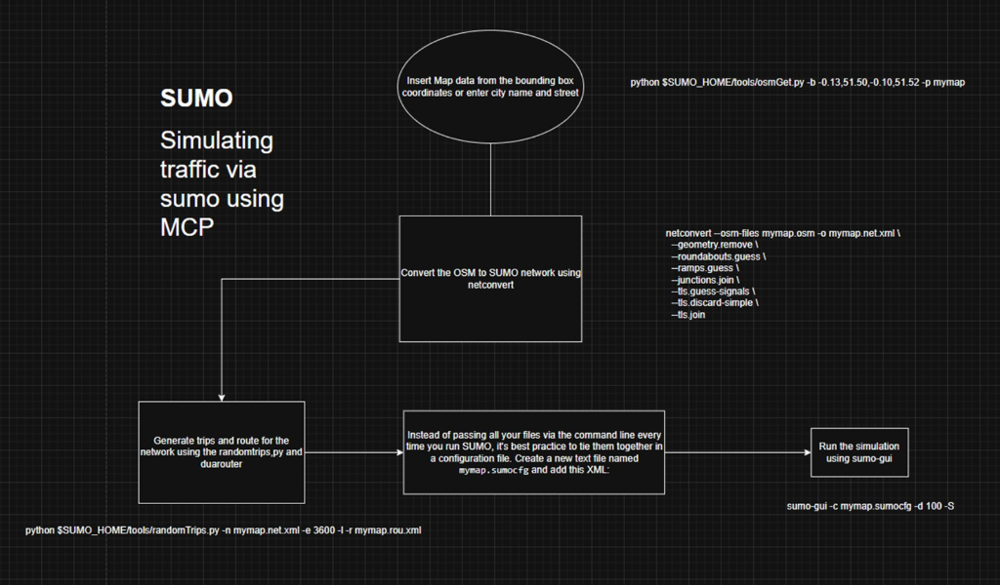
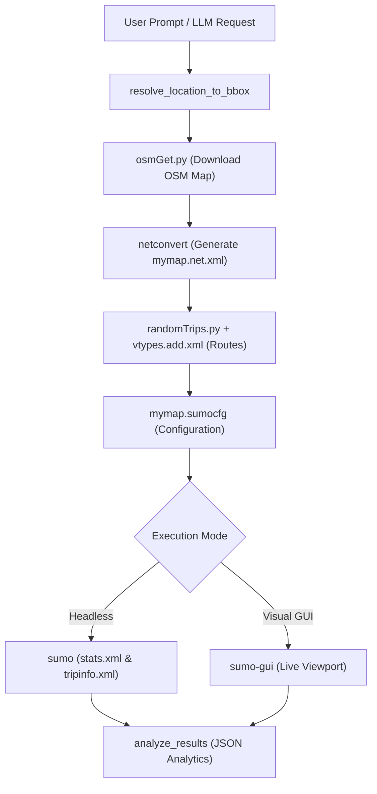
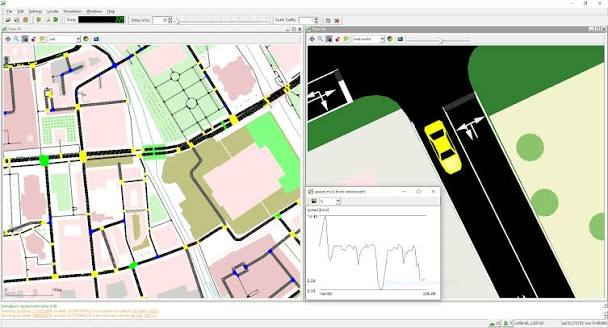
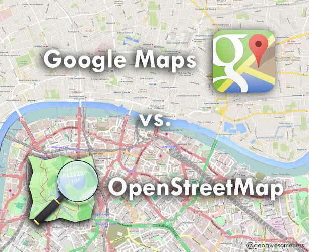
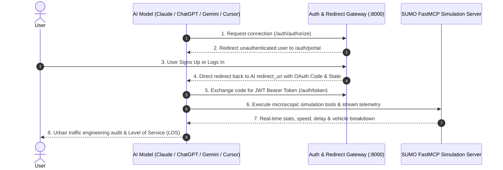

# 🚦 SUMO AI MCP – AI-Powered Urban Traffic Simulation Platform

[](https://github.com/Sanjay1266/Sumo_ai_mcp)
[](https://nitrostack.ai)
[](https://sumo.dlr.de)
[](https://python.org)
[](https://typescriptlang.org)
[](LICENSE)

**SUMO AI MCP** is an intelligent urban traffic simulation and analytics platform. It connects **Eclipse SUMO (Simulation of Urban Mobility)** with the **Model Context Protocol (MCP)** via **NitroStack** (TypeScript) and **FastMCP** (Python). 

Instead of manually crafting complex XML files or executing multi-step CLI commands, users and LLM agents can design, run, visualize, and audit microscopic traffic simulations through natural language.

---

## 📸 Workflow Architecture





---

## 🌐 Core Technologies

### 1. Eclipse SUMO Simulation Engine

- **Microscopic Modeling**: Simulates individual vehicles, motorcycles, buses, and trucks with explicit car-following and sublane physics (`lateral-resolution="0.8"`).
- **Automated Viewport**: Auto-calculates network spatial center and zoom level for optimal desktop GUI playback (`gui-settings.xml`).

### 2. OpenStreetMap (OSM) & Dynamic Geocoding

- **Nominatim Geocoding**: Resolves city/neighborhood names (*"Gandhipuram"*, *"Ettimadai"*, *"Coimbatore"*, *"Chennai"*, *"Bangalore"*) into focal bounding boxes (~2.5km × 2.5km).
- **OSM Overpass Integration**: Downloads real-world roads, lane counts, speed limits, and junction geometries automatically.

### 3. Model Context Protocol (MCP) & Heterogeneous Indian Traffic
- **Dual-Engine MCP**: TypeScript (NitroStack) for enterprise schema-validated tools, and Python (FastMCP) for native SUMO binary execution.
- **Heterogeneous Vehicles**: Pre-configured mixed traffic distribution (`vtypes.add.xml`): Motorcycles (35%), Autorickshaws (20%), Cars (30%), Buses (8%), and Trucks (7%).

---

## 📁 Project Structure

```
Sumo_simulation/
├── sumo_server.py           # Core FastMCP Python Server (Simulation Pipeline)
├── sumo_test_server.py      # FastMCP Python Test Server (Isolated Test Tools)
├── test_audit.py            # Standalone Empirical Metrics Audit Script
├── assets/                  # Workflow diagrams & visual documentation assets
├── src/
│   ├── app.module.ts        # Root Module (SumoModule + TestModule)
│   └── modules/
│       ├── sumo/            # Core Simulation Tools, Resources & Prompts
│       └── test/            # Dedicated Test Tools Module
├── Testcases/               # Pre-cached OpenStreetMap networks (map1.osm - map5.osm)
└── mymap.sumocfg            # Main SUMO Simulation Config
```

---

## 🛠️ MCP Tools & Resources Reference

### Core Simulation Tools
| Tool | Input Schema | Description |
|------|--------------|-------------|
| `generate_network` | `bbox: string` | Downloads OSM data for a place/bbox and generates `mymap.net.xml`. |
| `generate_routes` | `trips: int, duration: int, density: string` | Generates heterogeneous routes (`vtypes.add.xml`, `mymap.rou.xml`, `mymap.sumocfg`). |
| `run_headless_simulation` | *None* | Runs CLI SUMO simulation and outputs `stats.xml` & `tripinfo.xml`. |
| `run_gui_simulation` | `autoStart: bool, delay: int` | Launches desktop `sumo-gui` visual app with centered camera viewport. |
| `analyze_results` | *None* | Parses `stats.xml` and returns key metrics (loaded, inserted, avg route length). |
| `analyze_trip_details` | *None* | Parses `tripinfo.xml` for microscopic travel time, delay loss, speed (km/h), congestion index, and vehicle-type breakdown. |
| `run_full_simulation` | `bbox: string, trips: int, duration: int, launchGui: bool` | Master end-to-end simulation orchestration tool. |

### Dedicated Testing Tools
| Tool | Description |
|------|-------------|
| `test_geocoder` | Validates place-name resolution, coordinate clamping, and format. |
| `test_network_generation` | Validates OSM network download and `netconvert` compilation. |
| `test_route_generation` | Validates vehicle distribution, `randomTrips.py`, and `sumocfg`. |
| `test_simulation_execution` | Validates headless SUMO execution and XML report output. |
| `test_analytics_truthfulness` | Audits reported analytics against raw `stats.xml` metrics. |
| `run_all_test_cases` | Master runner executing all 5 test cases with a structured summary report. |

### Live MCP Resources
- `sumo://stats`: Real-time `stats.xml` contents.
- `sumo://tripinfo`: Real-time `tripinfo.xml` contents.
- `sumo://network`: Real-time `mymap.net.xml` network data.
- `sumo://config`: Real-time `mymap.sumocfg` configuration data.

---

## 🤖 Universal Multi-AI Model Integration & Direct Redirect Flow

The **SUMO AI MCP Server** can be directly connected to **any AI model of your choice**:



### 1. Ready-to-Use Integration Manifests
Pre-configured connection manifests are included for instant 1-click setup:

| AI Model / Environment | Configuration File | Supported Transports | Connection Protocol |
| :--- | :--- | :--- | :--- |
| **Anthropic Claude 3.5 Sonnet / Desktop** | [`claude_desktop_config.json`](claude_desktop_config.json) | STDIO / SSE | Native FastMCP |
| **OpenAI ChatGPT / Custom GPTs** | [`chatgpt_openapi_spec.json`](chatgpt_openapi_spec.json) | SSE / HTTP | OpenAPI 3.1 with OAuth2 Redirect |
| **Google Gemini 1.5 / Antigravity IDE** | [`gemini_mcp_config.json`](gemini_mcp_config.json) | STDIO / SSE | Multi-modal Reasoning & FastMCP |
| **Cursor AI IDE** | [`.cursor/mcp.json`](.cursor/mcp.json) | STDIO | In-Editor Agent Protocol |
| **VS Code Copilot / Cline** | [`vscode_mcp_config.json`](vscode_mcp_config.json) | STDIO | Model Context Protocol |
| **Ollama Local LLM (Llama 3 / DeepSeek)** | Built-in via `/ai-hub` | HTTP | 100% Offline & Private |

---

## 🔐 OAuth 2.1 Direct AI Redirect & Signup Portal

When connecting an AI client or web agent:
1. **Interactive Redirect Portal**: Navigate to `http://localhost:8000/auth/portal` (or initiate from your AI client).
2. **User Registration & Signup**: Complete sign up with email and password. Credentials are securely hashed with **PBKDF2-HMAC-SHA256** (100,000 rounds) and salted.
3. **Automatic AI Redirection**: The gateway issues an authorization code and **immediately redirects back to your connected AI model's callback URL** with the authorization token and state!
4. **JWT Security**: Access tokens use signed **HMAC-SHA256 (HS256)** with expiration and scope validation.

---

## 🎨 Interactive Multi-AI Simulation Studio (`/ai-hub`)

Launch the web studio at **`http://localhost:8000/ai-hub`**:
- **Model Selector**: Switch seamlessly between Google Gemini, Anthropic Claude, OpenAI GPT-4o, Ollama Local, and the Built-in SUMO Agent.
- **Corridor Geocoding**: 1-click presets for *Chennai Central*, *Gandhipuram*, *Ettimadai*, *Coimbatore*, *Bangalore*, *Delhi*, or custom coordinate bounding boxes.
- **Microscopic Telemetry**: Real-time Level of Service (LOS A through F) gauge, insertion rates, average delay, speed, and Indian mixed vehicle breakdown.
- **Live AI Reasoning**: The connected AI model explains bottleneck causes and recommends signal timing adjustments and sublane layout improvements.

---

## 🛡️ Security Architecture & Constraints

Detailed specifications are maintained in [**`SECURITY.md`**](SECURITY.md):
- **Command Injection Prevention**: All queries and place names are sanitized via `security_utils.sanitize_location_query()`; metacharacters (`;`, `&`, `|`, `$`, etc.) are stripped.
- **Overpass API Protection**: Maximum bounding box span is clamped to `0.05°` (~2.5km) to prevent API rate-limiting and timeouts.
- **Simulation Parameter Clamping**: Vehicle trips (1–5,000) and duration (10s–86,400s) are bounded to avoid CPU starvation.
- **Subprocess Isolation**: External binaries are called as argument lists (`subprocess.run([...], shell=False)`).

---

## 🚀 Setup & Verification

### 1. Installation & Environment Setup
```bash
git clone https://github.com/Sanjay1266/Sumo_ai_mcp.git
cd Sumo_ai_mcp

npm install
pip install -r requirements.txt # or: pip install fastmcp fastapi uvicorn pydantic
```

Copy `.env.example` to `.env`:
```bash
cp .env.example .env
```

### 2. Running Servers
```bash
# Start Auth Gateway & Multi-AI Studio on http://localhost:8000
python auth_server.py
# (or: npm run start:auth)

# Start SUMO FastMCP Server in SSE mode (for web AI models)
python sumo_server.py --transport sse --port 8000
# (or in STDIO mode for Claude/Cursor: python sumo_server.py --transport stdio)
```

### 3. Running Comprehensive Test Suite
```bash
# Execute comprehensive 5-module validation test (Security, OAuth, AI Router, Studio, SUMO Tools)
python test_ai_integration.py
# (or: npm run test:ai)
```

---

## 📜 License
Distributed under the MIT License.
