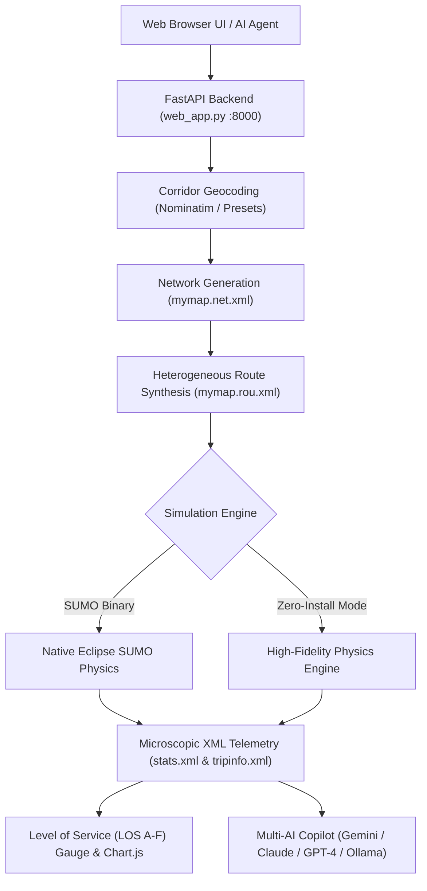

# 🚦 SUMO AI Web Application & MCP Platform

[](https://github.com/Sanjay1266/Sumo_ai_mcp)
[](http://localhost:8000)
[](https://sumo.dlr.de)
[](https://python.org)
[](https://modelcontextprotocol.io)
[](LICENSE)

**SUMO AI Web Application** is a full-stack urban traffic simulation, microscopic telemetry, and multi-AI analytics platform. It converts the microscopic simulation power of **Eclipse SUMO (Simulation of Urban Mobility)** into an intuitive, interactive web application paired with an enterprise **Model Context Protocol (MCP)** server.

Users can design, simulate, visualize, and audit complex traffic networks across Indian and global city corridors through a modern browser dashboard or via conversational AI agents.

---

## 🌟 Key Capabilities & Architecture



---

## 🚀 Quickstart: Running the Web Application

### 1. Installation
```bash
git clone -b Webapplication https://github.com/Sanjay1266/Sumo_ai_mcp.git
cd Sumo_ai_mcp

# Install Python requirements
pip install -r requirements.txt

# (Optional) Install Node dependencies
npm install
```

### 2. Launching the Web Application
Start the standalone web application with automatic browser launch:
```bash
python web_app.py --open-browser
# or using npm:
npm start
```

Open your browser at **`http://localhost:8000`**:
- **Simulation Studio**: Interactive control panel, Leaflet map, and real-time execution console.
- **Microscopic Telemetry & Charts**: Speed charts, vehicle distribution, and microscopic vehicle trip tables.
- **Multi-AI Engineering Copilot**: Chat with Gemini, Claude, GPT-4o, Ollama, or Built-in Expert.
- **Fullscreen GIS Viewport**: High-resolution OpenStreetMap corridor inspection.
- **Run History**: Save and compare scenarios side-by-side.
- **API Documentation**: Interactive Swagger UI at `http://localhost:8000/docs`.

---

## 🖥️ Web Application Dashboard Modules

### 1. Interactive GIS Corridor Map (Leaflet.js)
- Visualizes the exact focal bounding box (~2.5km × 2.5km) on OpenStreetMap.
- 1-click corridor presets for:
  - **Gandhipuram Cross Cut Road** (*Coimbatore*)
  - **Chennai Central & Poonamallee High Rd** (*Chennai*)
  - **Ettimadai – Amrita University** (*Coimbatore*)
  - **Silk Board Junction** (*Bangalore*)
  - **Connaught Place** (*New Delhi*)
  - **Bandra-Kurla Complex / BKC** (*Mumbai*)
  - **Hitec City & Cyber Towers** (*Hyderabad*)
  - **Peelamedu – Avinashi Road** (*Coimbatore*)

### 2. Heterogeneous Indian Traffic Mix Configurator
- Explicit sublane physics (`lateral-resolution="0.8"`) modeling non-lane-based traffic.
- Customizable vehicle category sliders with real-time percentage normalization:
  - 🏍️ **Motorcycles** (35%)
  - 🛺 **Auto-rickshaws** (20%)
  - 🚗 **Passenger Cars** (30%)
  - 🚌 **City Buses** (8%)
  - 🚚 **Heavy Commercial Trucks** (7%)

### 3. Highway Capacity Level of Service (LOS) Engine
- Computes empirical Level of Service (**LOS A** through **LOS F**) based on average time loss and vehicle delay:
  - **LOS A**: `< 10s delay` – Free Flow
  - **LOS B**: `10s–20s delay` – Stable Flow
  - **LOS C**: `20s–35s delay` – Fair Flow
  - **LOS D**: `35s–55s delay` – Dense Flow
  - **LOS E**: `55s–80s delay` – Unstable Flow
  - **LOS F**: `> 80s delay` – Forced Breakdown

### 4. Multi-AI Traffic Engineering Copilot
- Switch seamlessly between:
  - **Built-in Expert**: 100% offline, deterministic rule-based traffic engineering agent.
  - **Google Gemini 1.5 / 2.0 Flash**: Multi-modal reasoning.
  - **Anthropic Claude 3.5 Sonnet**: Geometric road layout and signal timing specialist.
  - **OpenAI GPT-4o**: General urban transport planning.
  - **Ollama Local LLM**: Offline private inference (Llama 3, DeepSeek).
- One-click prompt actions:
  - *"Analyze Bottlenecks & Congestion Causes"*
  - *"Recommend Traffic Signal Timing Optimizations"*
  - *"Evaluate Dedicated Bus & Motorcycle Sublanes"*
  - *"HCM Level of Service (LOS) Audit"*

---

## 📁 Project Structure

```
Sumo_ai_mcp/
├── web_app.py                 # Core FastAPI Web Application Server
├── sumo_server.py             # FastMCP Engine & SUMO Simulation Pipeline
├── ai_router.py               # Multi-AI Model Gateway (Gemini, Claude, GPT, Ollama)
├── auth_server.py             # OAuth 2.1 Authorization & Redirect Gateway
├── security_utils.py          # Input Sanitization, PBKDF2 Hashing & JWT Security
├── main.py                    # Unified Launcher (Web App, MCP, Auth)
├── test_web_app.py            # Comprehensive Web App Automated Test Suite
├── test_ai_integration.py     # AI & Security Integration Test Suite
├── test_audit.py              # Standalone Empirical Metrics Truthfulness Audit
├── templates/
│   └── index.html             # Single-Page Web Application Frontend Template
├── static/
│   ├── css/styles.css         # Modern Cyber-Dark Glassmorphic UI Styles
│   └── js/app.js              # Leaflet GIS, Chart.js & Simulation Controller
├── Dockerfile                 # Containerized Deployment Specification
├── docker-compose.yml         # 1-Click Multi-Container Orchestration
├── requirements.txt           # Python Package Dependencies
└── package.json               # Project Manifest & NPM Run Scripts
```

---

## 🛠️ REST API Reference

| Method | Endpoint | Description |
| :--- | :--- | :--- |
| `GET` | `/` | Renders the primary Single-Page Web Application dashboard. |
| `GET` | `/api/system/status` | Returns system diagnostics, SUMO binary paths, and AI model status. |
| `GET` | `/api/presets` | Retrieves the curated corridor presets list. |
| `GET` | `/api/geocode?q={name}` | Geocodes a place name into coordinate bounds and center latitude/longitude. |
| `POST` | `/api/simulation/full` | Executes the complete end-to-end simulation pipeline. |
| `POST` | `/api/simulation/step/network` | Step 1: Generates `mymap.net.xml`. |
| `POST` | `/api/simulation/step/routes` | Step 2: Generates `mymap.rou.xml` and `mymap.sumocfg`. |
| `POST` | `/api/simulation/step/execute` | Step 3: Executes headless microscopic physics simulation. |
| `POST` | `/api/simulation/step/gui` | Step 3b: Launches desktop `sumo-gui` visual viewport. |
| `GET` | `/api/analytics/results` | Returns loaded, inserted, and route length statistics. |
| `GET` | `/api/analytics/trips` | Microscopic travel time, speed (km/h), delay loss, and vehicle breakdown. |
| `GET` | `/api/analytics/xml/{file}` | Inspects raw XML simulation output files. |
| `POST` | `/api/ai/chat` | Routes prompt and simulation telemetry to the selected AI model. |
| `GET` | `/api/history` | Retrieves saved simulation runs. |
| `GET` | `/api/stream/events` | Server-Sent Events (SSE) live progress and log stream. |
| `GET` | `/docs` | Auto-generated interactive OpenAPI Swagger UI. |

---

## 🔌 Universal Model Context Protocol (MCP) Integration

The server functions simultaneously as an **MCP server** for desktop AI clients:

### 1. Claude Desktop (`claude_desktop_config.json`)
```json
{
  "mcpServers": {
    "sumo-simulation": {
      "command": "python",
      "args": ["sumo_server.py", "--transport", "stdio"]
    }
  }
}
```

### 2. Cursor AI (`.cursor/mcp.json`)
```json
{
  "mcpServers": {
    "sumo": {
      "command": "python",
      "args": ["sumo_server.py"]
    }
  }
}
```

### 3. Remote SSE Endpoint
```
http://localhost:8000/sse
```

---

## 🐳 Docker Deployment

Run the complete SUMO AI Web Application in an isolated container:

```bash
docker-compose up --build
```
Access the application at `http://localhost:8000`.

---

## 🧪 Verification & Testing

Run all automated test suites to ensure 100% system integrity:

```bash
# 1. Web Application Endpoints & Dashboard Suite
python test_web_app.py

# 2. Multi-AI & Security Integration Suite
python test_ai_integration.py

# 3. Microscopic XML Truthfulness Audit
python test_audit.py

# Or run all at once:
npm run test:all
```

---

## 📄 License
Released under the [MIT License](LICENSE). Developed by **Sanjay S**.
